<!--
  SETUP: search this file for YOUR_ and replace every placeholder.
  Placeholders: Princy Ghetiya, YOUR_GITHUB_USERNAME, YOUR_EMAIL, YOUR_LINKEDIN_URL, YOUR_PORTFOLIO_URL
  Also replace the "Princy Ghetiya" text inside assets/hero.svg and assets/footer.svg.
  Project cards are concepts: replace titles, descriptions, and links with your real work.
  Delete any technology you cannot back up with a repository.
-->

 

## Princy Ghetiya

**AI/ML Engineer | Software Engineer**

I build machine learning systems and the software around them. My work covers statistical modeling, deep learning, and natural language processing, with attention to the parts that make models usable: data pipelines, validation, evaluation, and inference.

I care about turning research ideas into software other people can run, test, and extend. That means reproducible experiments, honest baselines, clear metrics, readable code, and documentation that matches what the code does.

- Python-first, with PyTorch, TensorFlow, and scikit-learn
- Evaluation before optimization: baselines, appropriate metrics, error analysis
- Clean architecture, automated tests, and maintainable interfaces

 

## Technical Expertise

<!-- Edit freely. Remove anything you cannot substantiate with a repository. -->

<table>
<tr>
<td width="200"><b>Languages</b></td>
<td>

<!-- Add your other languages here -->
</td>
</tr>
<tr>
<td><b>Machine Learning</b></td>
<td>

 Model selection · feature engineering · evaluation · statistical learning
</td>
</tr>
<tr>
<td><b>Deep Learning</b></td>
<td>

 Neural networks · optimization · training workflows
</td>
</tr>
<tr>
<td><b>Data Science</b></td>
<td>

 Exploratory data analysis · data visualization
</td>
</tr>
<tr>
<td><b>NLP</b></td>
<td>

 Text preprocessing · embeddings · text classification · language modeling · transformer-based methods
</td>
</tr>
<tr>
<td><b>Software Engineering</b></td>
<td>
Object-oriented design · data structures and algorithms · clean architecture · debugging · testing · design principles
</td>
</tr>
<tr>
<td><b>Developer Tools</b></td>
<td>

</td>
</tr>
<tr>
<td><b>Databases and Deployment</b></td>
<td>
SQL databases · REST APIs · model serving · deployment
</td>
</tr>
</table>

 

## Featured AI/ML Projects

<!--
  Each card has the same fields. To use one:
  1. Replace the title, problem, approach, stack, and details with your real project.
  2. Replace the repo link. Delete the demo link if there is no demo.
  Do not add metrics, stars, or accuracy numbers unless they come from your own results.
-->

<table>
<tr>
<td>

### [End-to-End Machine Learning System](https://github.com/YOUR_GITHUB_USERNAME/YOUR_REPO_1)

**Problem.** Turn raw tabular data into a dependable prediction service rather than a single notebook.

**Approach.** Modular pipeline from ingestion to inference, with a baseline model compared against stronger candidates under one evaluation protocol.

**Stack.** `Python` `pandas` `scikit-learn`

**Implementation details**
- Data validation and schema checks before training
- Feature engineering encapsulated in a reusable pipeline
- Cross-validated model selection with problem-appropriate metrics
- Serialized model and a documented inference entry point

[Repository](https://github.com/YOUR_GITHUB_USERNAME/YOUR_REPO_1) · [Demo](YOUR_DEMO_URL_1)

</td>
</tr>
<tr>
<td>

### [Deep Learning Application](https://github.com/YOUR_GITHUB_USERNAME/YOUR_REPO_2)

**Problem.** Train a neural network in a way that others can reproduce and inspect.

**Approach.** Config-driven training loop with tracked experiments and a clear separation between model, data, and training code.

**Stack.** `Python` `PyTorch` `NumPy`

**Implementation details**
- Experiment configuration stored alongside results
- Fixed seeds and pinned dependencies for reproducibility
- Experiment tracking for loss, metrics, and hyperparameters
- Evaluation on held-out data with error analysis notes

[Repository](https://github.com/YOUR_GITHUB_USERNAME/YOUR_REPO_2) · [Demo](YOUR_DEMO_URL_2)

</td>
</tr>
<tr>
<td>

### [NLP / Transformer-Based Application](https://github.com/YOUR_GITHUB_USERNAME/YOUR_REPO_3)

**Problem.** Classify or analyze text with a transformer model and make it accessible through a simple interface.

**Approach.** Text preprocessing and fine-tuning or inference with a pretrained transformer, evaluated against a simpler baseline.

**Stack.** `Python` `PyTorch` `Hugging Face Transformers`

**Implementation details**
- Preprocessing and tokenization pipeline with tests
- Baseline comparison (for example TF-IDF with a linear model)
- Evaluation with per-class metrics and documented limitations
- Application interface for interactive inference

[Repository](https://github.com/YOUR_GITHUB_USERNAME/YOUR_REPO_3) · [Demo](YOUR_DEMO_URL_3)

</td>
</tr>
</table>

 

## Featured Software Engineering Projects

<table>
<tr>
<td>

### [Production-Style Backend / API](https://github.com/YOUR_GITHUB_USERNAME/YOUR_REPO_4)

**Problem.** Provide a well-structured API with predictable behavior, not just working endpoints.

**Approach.** Layered architecture separating routing, business logic, and persistence, with explicit contracts at each boundary.

**Stack.** `Python` `FastAPI` `SQL` `Docker`

**Implementation details**
- Request and response validation
- Consistent error handling and status codes
- Unit and integration tests
- Generated API documentation and a setup guide

[Repository](https://github.com/YOUR_GITHUB_USERNAME/YOUR_REPO_4) · [Demo](YOUR_DEMO_URL_4)

</td>
</tr>
<tr>
<td>

### [Full-Stack or Developer Tool Project](https://github.com/YOUR_GITHUB_USERNAME/YOUR_REPO_5)

**Problem.** Build a useful application or tool that shows design judgment and integration across components.

**Approach.** Small, composable modules with clear interfaces, so features can be added without rewriting existing code.

**Stack.** `Python` `REST` `Git` `CI/CD`

**Implementation details**
- Maintainable project structure and documented design decisions
- Integration between interface, services, and data layer
- Automated checks run in CI
- Contribution and usage documentation

[Repository](https://github.com/YOUR_GITHUB_USERNAME/YOUR_REPO_5) · [Demo](YOUR_DEMO_URL_5)

</td>
</tr>
</table>

 

## Engineering Practices

 

These are the practices I apply to ML work. Each links to a repository that demonstrates it; replace the links with your own.

| Practice | What it means in my work | Example |
|---|---|---|
| Data preparation and validation | Schema checks, missing-value handling, leakage prevention | [repo](https://github.com/YOUR_GITHUB_USERNAME/YOUR_REPO_1) |
| Training and evaluation pipelines | One command from data to metrics | [repo](https://github.com/YOUR_GITHUB_USERNAME/YOUR_REPO_1) |
| Baselines and model selection | Simple models first, complexity only when justified | [repo](https://github.com/YOUR_GITHUB_USERNAME/YOUR_REPO_3) |
| Metrics that fit the problem | Choose metrics from the cost of errors, not convention | [repo](https://github.com/YOUR_GITHUB_USERNAME/YOUR_REPO_3) |
| Reproducibility | Seeds, pinned dependencies, versioned configuration | [repo](https://github.com/YOUR_GITHUB_USERNAME/YOUR_REPO_2) |
| Error analysis and limitations | Inspect failures and document where the model should not be trusted | [repo](https://github.com/YOUR_GITHUB_USERNAME/YOUR_REPO_2) |
| Serialization and inference | Versioned artifacts and a clear prediction interface | [repo](https://github.com/YOUR_GITHUB_USERNAME/YOUR_REPO_1) |
| API integration and deployment | Model serving behind validated endpoints | [repo](https://github.com/YOUR_GITHUB_USERNAME/YOUR_REPO_4) |
| Testing and documentation | Tests for data, code, and interfaces; READMEs that stay accurate | [repo](https://github.com/YOUR_GITHUB_USERNAME/YOUR_REPO_4) |

 

## GitHub Statistics

<!--
  These images come from third-party services that can be slow or rate-limited.
  If one fails, GitHub shows the alt text. The profile link below always works.
  Hosted instances: github-readme-stats.vercel.app is the shared public instance and is often rate-limited.
  For reliability, deploy your own copy: https://github.com/anuraghazra/github-readme-stats
-->

<a href="https://github.com/YOUR_GITHUB_USERNAME">
<picture>
  <source media="(prefers-color-scheme: light)" srcset="https://github-readme-stats.vercel.app/api?username=YOUR_GITHUB_USERNAME&show_icons=true&hide_border=true&bg_color=ffffff&title_color=0891b2&icon_color=7c3aed&text_color=334155">
  
</picture>
</a>
<a href="https://github.com/YOUR_GITHUB_USERNAME?tab=repositories">
<picture>
  <source media="(prefers-color-scheme: light)" srcset="https://github-readme-stats.vercel.app/api/top-langs/?username=YOUR_GITHUB_USERNAME&layout=compact&hide_border=true&bg_color=ffffff&title_color=0891b2&text_color=334155">
  
</picture>
</a>

 

<a href="https://github.com/YOUR_GITHUB_USERNAME">
<picture>
  <source media="(prefers-color-scheme: light)" srcset="https://streak-stats.demolab.com?user=YOUR_GITHUB_USERNAME&hide_border=true&background=ffffff&ring=0891b2&fire=7c3aed&currStreakLabel=0891b2&sideLabels=334155&currStreakNum=334155&sideNums=334155&dates=64748b">
  
</picture>
</a>

 

<a href="https://github.com/YOUR_GITHUB_USERNAME">
<picture>
  <source media="(prefers-color-scheme: light)" srcset="https://github-readme-activity-graph.vercel.app/graph?username=YOUR_GITHUB_USERNAME&hide_border=true&bg_color=ffffff&color=0891b2&line=7c3aed&point=334155&area=true&area_color=22d3ee">
  
</picture>
</a>

Statistics are generated live by third-party services. <a href="https://github.com/YOUR_GITHUB_USERNAME">View the full profile on GitHub</a>.

 

## Connect

  

